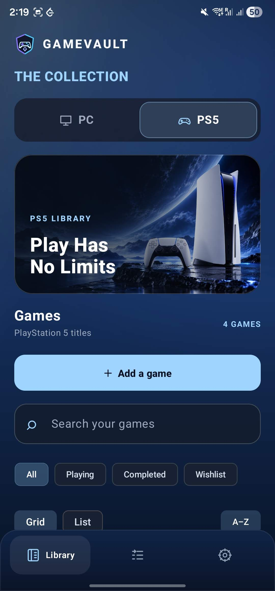
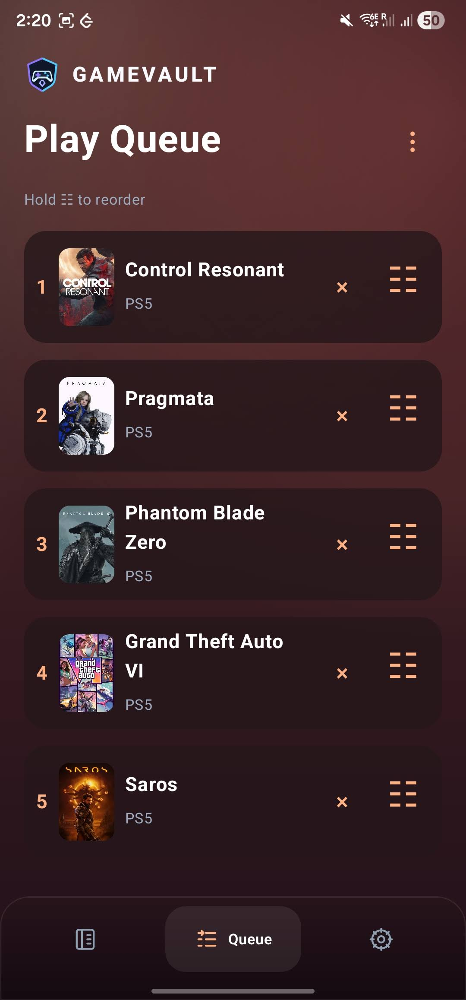

# 🎮 GameVault

**Your games. Your collection. One vault.**

A beautiful Android app to organize your **PC & PS5 games**, manage your backlog, and decide what to play next.

**[⬇ Download GameVault APK](https://github.com/NefariousNiru/GameVault/releases)**

---

## ✨ Features

- **One Unified Library** — Track PC and PS5 games without duplicates. Switch platforms anytime.
- **Play Queue** — One drag-and-drop backlog across both platforms.
- **Detailed Tracking** — Manage play status, wishlist, downloads, ownership, ratings, and notes.
- **Beautiful Artwork** — Customize portrait album art and landscape cover images.
- **Smart Game Search** — Instantly discover titles and metadata through RAWG.
- **Cloud Sync** — Secure Google sign-in with Firebase synchronization across devices.
- **Offline Access** — Browse cached games and artwork without internet.
- **Backup & Restore** — Export, import, merge, and recover your library with JSON backups.

## 📱 Screenshots

| The Collection | The Play Queue |
| :---: | :---: |
|  |  |

## 🚀 Getting Started

**1. Install GameVault**

Download the latest `.apk` from [GitHub Releases](https://github.com/NefariousNiru/GameVault/releases). Android 8.0+ supported.

**2. Sign in with Google**

Your personal collection stays synced across devices.

**3. Add your API keys — Highly Recommended**

For the best experience, grab free-tier API keys from both services:

| Service | Purpose | Get Key |
|---|---|---|
| **RAWG** | Game search, metadata, release dates, genres | [Get RAWG Key](https://rawg.io/apidocs) |
| **SteamGridDB** | High-quality album art and cover images | [Get SteamGridDB Key](https://www.steamgriddb.com/profile/preferences/api) |

Both offer free-tier access for personal use, subject to provider limits. Getting started usually takes just a few minutes.

Enter your keys in **Settings → Game Search & Artwork**.

*API keys are stored on your device. You can also add games manually without them.*

## 🔒 Your Collection, Your Data

Your library is private to your Google account and synchronized through Firebase. Export your collection whenever you want, restore from backups, and access previously cached content offline.

## ❤️ Credits

Powered by [RAWG](https://rawg.io/) for game metadata and [SteamGridDB](https://www.steamgriddb.com/) for artwork.

GameVault is an independent, unofficial project. All third-party game titles, artwork, and trademarks belong to their respective owners.

---

**Made by [Nirupom Bose Roy](https://www.linkedin.com/in/nbroy/)**

[GitHub Releases](https://github.com/NefariousNiru/GameVault/releases) · [LinkedIn](https://www.linkedin.com/in/nbroy/)